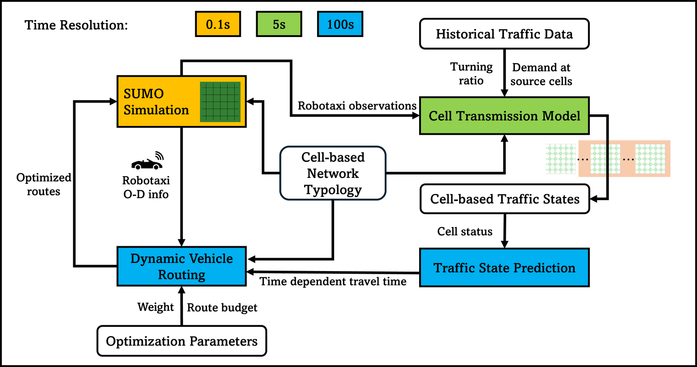

- **Authors**: Yilin Wang, Yiheng Feng (Purdue University)
- **Role**: first author; individual dissertation project in the CART Lab, Purdue University
- **Period**: Apr 2023 – Jun 2026 for the umbrella project *Cooperative Perception CAV Fleet Operation for Data Collection*; RoboSense itself Sept 2024 – Jun 2026
- **Funding**: the RoboSense paper acknowledges NSF CAREER award CMMI-2339753 and the USDOT Center for Connected and Automated Transportation (CCAT)
- **Status**: under revision at *Transportation Research Part C: Emerging Technologies*; preprint on arXiv
- **Links**: [arXiv:2609.06813](https://arxiv.org/abs/2609.06813) · [code on GitHub](https://github.com/Dylan-Wyl10/RoboSense)

## Overview
Robotaxis are dispatched to carry passengers, but a centrally controlled fleet can also double as a network of drive-by sensors. RoboSense is a dynamic routing framework that makes traffic monitoring an explicit objective of fleet operation. It follows an earlier study in the same umbrella project on routing connected and automated vehicles (CAVs) for network coverage (see [Earlier work](#earlier-work-dynamic-routing-of-connected-and-automated-vehicles-for-improving-network-coverage) below).

## Research Questions
1. **Network representation**: a higher-granularity representation of the road network is needed.
2. **Performance metric**: a proper metric is needed to evaluate the impact on traffic monitoring.
3. **Routing and observation**: CAV route decisions and the partial network observations they produce affect each other dynamically.

## Contributions
1. Apply the Cell Transmission Model (CTM) for traffic state prediction and for a road network representation that accounts for how CAVs detect traffic.
2. Propose a comprehensive mixed-integer linear programming (MILP) formulation that covers traffic monitoring performance and dynamic vehicle routing in one explicit equation.
3. Conduct microscopic simulations and evaluations under various scenarios.

## Methodology
- A **cell-based network representation** aligned with vehicle sensing range, built on CTM traffic-state prediction.
- A **cell-level spatiotemporal coverage metric** that quantifies how well the fleet observes the network.
- A **rolling-horizon MILP** that trades off passenger travel time against network monitoring coverage.
- **Evaluation** in SUMO on a 5×5 urban grid network at 2%, 5%, and 10% robotaxi market penetration rates.

## Findings
- Monitoring-aware routing substantially increased spatiotemporal network coverage.
- With suitable objective weights, robotaxi travel time also fell, so monitoring performance and robotaxi average speed improved together. This win-win could incentivize operators to contribute their vehicles as drive-by sensors.
- Once detours only add distance, the fleet's sensing power drops.

## Outcomes
- **Journal manuscript**: Yilin Wang, Yiheng Feng. "RoboSense: Leveraging Robotaxi Fleets as Drive-by Sensors for Urban Traffic Monitoring." Under revision at *Transportation Research Part C: Emerging Technologies*. Preprint: [arXiv:2609.06813](https://arxiv.org/abs/2609.06813), posted Sept 6, 2026.
- **Talk**: INFORMS 2026 Annual Meeting, San Francisco, CA, Nov 3, 2026 ([talk page]({{ '/talks/2026-informs-robosense' | relative_url }})).
- **Poster**: "A Cooperative Perception Based Dynamic Vehicle Routing Framework for Urban Traffic Monitoring," TRB Annual Meeting 2026, Washington, DC ([talk page]({{ '/talks/2026-trb-vehicle-routing' | relative_url }})).
- **Code**: [GitHub: Dylan-Wyl10/RoboSense](https://github.com/Dylan-Wyl10/RoboSense)

## Earlier Work: Dynamic Routing of Connected and Automated Vehicles for Improving Network Coverage
*Apr 2023 – Aug 2024*

- **Research question**: how to model the network coverage of CAVs and route them to improve data collection.
- **Contributions**: formulated the CAV routing problem with network coverage as one objective; proposed heuristic algorithms with greedy search to solve the multi-objective optimization; ran simulation experiments in a grid network to verify feasibility and the relation between travel cost and network coverage.
- **Methodology**: heuristic optimization, SUMO simulation, link-based travel time estimation.
- **Outcome**: accepted as a poster presentation at the [TRB Annual Meeting 2024](https://www.nationalacademies.org/event/806_01-2024_trb-annual-meeting) ([talk page]({{ '/talks/2024-trb-routing' | relative_url }})).
